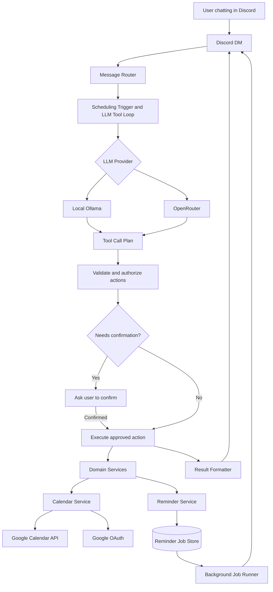
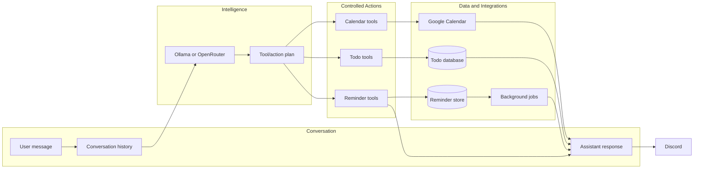

# Discord Personal Assistant — Current Design and Future Plan

## Current Design

This is a Discord DM personal assistant written in TypeScript.

Eligible scheduling DMs flow through:

```text
Discord DM
→ message handler
→ scheduling trigger
→ LLM tool plan
→ validated tool call
→ application service
→ Discord response
```

The LLM can run through:

- Local Ollama for privacy and local control.
- OpenRouter for hosted models and model flexibility.

The LLM does not directly modify data. It requests controlled tools, such as:

- Create a calendar event
- Schedule a reminder

The application validates the request, handles timezones, performs the action, persists the result, and reports back to Discord.

## Architecture Diagram



## Current Capabilities

- `/gcalendar` lists upcoming Google Calendar events.
- Google OAuth handles Calendar authorization.
- Natural-language calendar creation is supported.
- Local LLM and OpenRouter clients are supported.
- Tool calling is implemented.
- Reminders are persisted to a JSON file.
- A background job runner sends due reminders.
- Confirmation exists for reminders and multiple actions.
- Calendar and reminder intent is interpreted through the LLM tool plan before application validation.

## Current Limitations

- The current assistant entry point is still centered around calendar requests.
- Todos do not exist yet.
- Conversation memory does not exist yet.
- Calendar tokens are global rather than user-specific.
- Reminder storage is currently a JSON file.
- The bot is restricted to configured developer IDs.

## Future Design

The project is becoming a conversational personal assistant rather than a collection of commands.

The main interface will be ordinary Discord conversation:

- “Remind me tomorrow.”
- “What’s on my calendar Friday?”
- “Add buy milk to my todos.”
- “What do I still need to do?”
- “Move that appointment to 4pm.”

The assistant will have a growing set of controlled tools:

- Calendar tools
- Todo tools
- Reminder tools
- Eventually notes, recurring tasks, summaries, and other personal workflows

The LLM acts as the interpreter and planner. The application remains responsible for:

- Validating tool arguments
- Enforcing user ownership
- Handling permissions
- Managing confirmations
- Managing dates and timezones
- Calling external APIs
- Saving data
- Reporting success or failure

The long-term architecture is:

```text
Conversation layer
  → LLM provider abstraction
  → assistant/tool orchestration
  → domain services
  → persistence and external integrations
```

The future assistant should support short-term conversation context so users can say things like:

- “Actually, make that Friday.”
- “Cancel the second one.”
- “Yes, confirm it.”

## Future Architecture Diagram



## Core Safety Boundary

```text
LLM suggests an action
→ application validates it
→ confirmation happens if needed
→ application executes it
→ bot reports the result
```

The central design principle is that the model should be flexible, while tools, domain services, permissions, persistence, and integrations remain strict and predictable.
